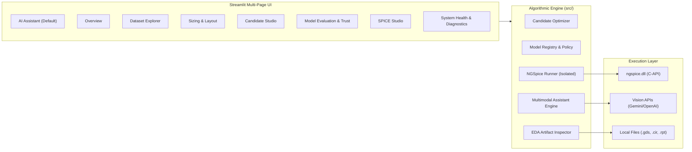

# SiliconPilot AI — Analog IC Layout Engineering Assistant & CAD Cockpit

[](https://www.python.org/)
[](LICENSE)
[](tests/)
[](docs/PROJECT_ARCHITECTURE.md)
[](dashboard/pages/ai_assistant.py)

> **SiliconPilot AI** is an intelligent, local, computer-aided design (CAD) exploration cockpit and engineering assistant for Analog Integrated Circuit (IC) design. It combines fast parametric machine-learning surrogates, multiobjective Pareto sizing trade-off exploration, deterministic SPICE circuit simulation with worker process isolation, a unified conversational Gemini assistant for layout inspection, and comprehensive system health diagnostics.

---

## Table of Contents
1. [Project Overview](#1-project-overview)
2. [Problem Statement](#2-problem-statement)
3. [Project Objectives](#3-project-objectives)
4. [Key Features](#4-key-features)
5. [System Architecture](#5-system-architecture)
6. [Technology Stack](#6-technology-stack)
7. [Project Directory Structure](#7-project-directory-structure)
8. [Installation Instructions for Windows](#8-installation-instructions-for-windows)
9. [Virtual Environment Setup](#9-virtual-environment-setup)
10. [Dependency Installation](#10-dependency-installation)
11. [ngspice / KiCad Configuration](#11-ngspice--kicad-configuration)
12. [Gemini & OpenAI API Configuration](#12-gemini--openai-api-configuration)
13. [Application Launch Instructions](#13-application-launch-instructions)
14. [Testing & Verification](#14-testing--verification)
15. [Visual Interface & Screenshots](#15-visual-interface--screenshots)
16. [Model Descriptions & Trust Limitations](#16-model-descriptions--trust-limitations)
17. [Current Capabilities](#17-current-capabilities)
18. [Known Limitations](#18-known-limitations)
19. [Future Roadmap](#19-future-roadmap)
20. [Acknowledgements & License](#20-acknowledgements--license)

---

## 1. Project Overview
Analog IC layout remains one of the most knowledge-intensive, iterative, and manual phases in semiconductor engineering. Small placement variations, routing asymmetries, and parasitic resistances/capacitances (PEX) can degrade circuit performance, compromise phase margin, or cause severe common-mode offset errors.

**SiliconPilot AI** provides a unified engineering workbench where designers can:
* Consult a conversational, multimodal Gemini AI assistant with in-composer layout attachments and follow-up memory.
* Rapidly explore transistor sizing trade-offs ($W, L, M, N_{fingers}$) using surrogate models.
* Evaluate candidate Pareto frontiers across gain, bandwidth, phase margin, and area.
* Execute automated, deterministic SPICE simulations (AC frequency and transient) via an isolated C-API runner.
* Monitor runtime health, hardware resources, active API probes, and model trust boundaries through System Health & Diagnostics.

---

## 2. Problem Statement
Unlike digital IC design—which benefits from automated logic synthesis, standard cell place-and-route, and static timing analysis—analog design relies heavily on expert heuristics (e.g., common-centroid interdigitation, dummy poly rings, substrate guard rings, and symmetry matching). 

Designers face two critical bottlenecks:
1. **Simulation Latency:** Iteratively running full-chip post-layout transient/AC SPICE simulations during early sizing exploration is computationally prohibitive.
2. **Deceptive Verification Risk:** Traditional ML prototypes frequently hallucinate "clean" DRC status or output non-physical electrical predictions without transparent lineage.

---

## 3. Project Objectives
* **Engineering Credibility:** Enforce transparent provenance labelling across all UI components (`[SIMULATED]`, `[SURROGATE]`, `[SYNTHETIC]`, `[OBSERVED]`).
* **Deterministic Verification:** Integrate real SPICE simulation using an in-process, isolated C-API bridge (`ngspice.dll`) to validate circuit candidates under testbenches.
* **Fail-Closed Model Policy:** Quarantine flawed models (e.g., classifiers that collapse to trivial majorities or regressors with negative $R^2$) to protect design integrity.
* **Multimodal Layout Review:** Provide a unified ChatGPT-like AI assistant capable of analyzing layout floorplans and explaining DRC/LVS logs without claiming to replace signoff physical verification.
* **Actionable System Telemetry:** Provide comprehensive health diagnostics with live API latency and ngspice simulation smoke tests.

---

## 4. Key Features
* **Unified Conversational Copilot:** Real-time multi-turn chat powered by Google Gemini (`gemini-3.8-flash` / `gemini-3-flash-preview`), supporting in-composer attachments, thumbnail previews, and retry capabilities.
* **Structured 6-Section Analog Review:** Enforces rigorous layout inspection (Layout Overview, Device Identification, Layout Strategy, Critical Vulnerabilities, Suggested Improvements, Verification Imperatives).
* **System Health & Diagnostics:** 8 diagnostic sections covering Runtime, Host Hardware, AI Telemetry (active test button), SPICE Simulation (active smoke test), Datasets, Model Trust, EDA Tools, and Logs.
* **Interactive Sizing & Surrogate Intelligence:** Real-time geometric and aspect ratio exploration for multi-finger transistors.
* **Pareto Candidate Optimization Studio:** Multi-objective ranking of candidate designs across competing analog performance vectors.
* **Worker-Isolated SPICE Engine:** Seamless AC frequency response, transient step response, and DC operating-point simulation for Miller Two-Stage, Folded Cascode, Telescopic, and 5T-OTA circuits.
* **EDA Artifact & Netlist Inspector:** Read-only ingestion of GDSII, OASIS, LEF, DEF, and SPICE netlists with cell count and layer hierarchy extraction.
* **Declarative Trust Enforcer:** Strict JSON-based model policy preventing unverified models from steering sizing decisions.

---

## 5. System Architecture
SiliconPilot AI separates the presentation layer from algorithmic computation and native EDA backends:


        Disk["Local Files (.gds, .cir, .rpt)"]
    end

    UI --> Core
    SPICE --> ngspice
    Vision --> APIs
    EDA --> Disk
```
*See [docs/PROJECT_ARCHITECTURE.md](docs/PROJECT_ARCHITECTURE.md) for full architectural documentation.*

---

## 6. Technology Stack
* **Language & Runtime:** Python 3.11.9 64-bit.
* **Dashboard Framework:** Streamlit (Native multi-page architecture).
* **Machine Learning:** Scikit-Learn, Joblib, NumPy, Pandas, Narwhals, PyArrow.
* **Simulation Engine:** ngspice (Shared C-library via `ctypes` in isolated subprocess).
* **Physical Layout Parsing:** `gdstk` (GDSII / OASIS layout geometry parsing).
* **Multimodal AI:** Google Gemini API (`gemini-3.8-flash`) and OpenAI API (`gpt-6-astra`).
* **Testing:** Pytest, pytest-subtests, AnyIO.

---

## 7. Project Directory Structure
```text
SiliconPilot-AI/
├── .streamlit/                     # Streamlit theme & secrets templates
│   ├── config.toml                 # Custom dark theme configuration
│   └── secrets.example.toml        # Template for optional API credentials
├── config/                         # Configuration and declarative policies
│   ├── model_trust_policy.json     # Declarative fail-closed trust boundaries
│   └── settings.py                 # Project paths and environment bindings
├── dashboard/                      # UI presentation layer
│   ├── app.py                      # Multi-page router and entry point
│   ├── chat.py                     # Deterministic local engineering knowledge base
│   ├── components/                 # Reusable UI widgets and badge renderers
│   └── pages/                      # Native Streamlit application pages
├── data/                           # Data storage
│   ├── raw/                        # Heavy benchmark caches (Git-ignored)
│   └── sample/                     # Synthetic demonstration benchmarks (tracked)
├── docs/                           # Comprehensive technical documentation
│   ├── DEVELOPMENT_STATUS.md       # Implementation status and test log
│   ├── INSTALLATION_GUIDE.md       # Step-by-step Windows setup guide
│   ├── KNOWN_LIMITATIONS.md        # Explicit evidence boundaries & disclosures
│   └── PROJECT_ARCHITECTURE.md     # In-depth architectural design
├── models/                         # Serialized ML artifacts
│   └── saved_models/
│       └── models_manifest.json    # Model evaluation metadata and signatures
├── scripts/                        # Automation & launch scripts
│   ├── run_local.ps1               # Automated Windows launcher (KiCad setup)
│   └── train_baseline_models.py    # Baseline model training and evaluation script
├── src/                            # Algorithmic core package
│   ├── assistant/                  # Multimodal vision engines & providers
│   ├── data/                       # Dataset loaders and schema inspectors
│   ├── eda/                        # GDSII, OASIS, LEF, DEF, and DRC parsers
│   ├── models/                     # Model registry and policy enforcement
│   ├── optimization/               # Candidate generation and Pareto sorting
│   ├── simulation/                 # ngspice C-API runner and netlist manager
│   └── utils/                      # Logging and short path helpers
├── tests/                          # Automated unit and integration test suite
├── .env.example                    # Environment variable template
├── .gitignore                      # Comprehensive Git exclusion rules
├── CONTRIBUTING.md                 # Contribution guidelines
├── pytest.ini                      # Pytest discovery configuration
├── README.md                       # Master project documentation
└── requirements.txt                # Pinned dependency requirements
```

---

## 8. Installation Instructions for Windows

### Prerequisites
* Windows 10 or 11 (64-bit).
* Python 3.11.x installed and added to `PATH`.
* KiCad 8.0, 9.0, or 10.0 (recommended for `ngspice.dll`), or standalone ngspice-shared.

---

## 9. Virtual Environment Setup
Open PowerShell in your workspace directory:
```powershell
git clone https://github.com/aakashlamba2021-create/SiliconPilot-AI.git
cd SiliconPilot-AI
python -m venv .venv
.\.venv\Scripts\Activate.ps1
```

---

## 10. Dependency Installation
```powershell
python -m pip install --upgrade pip
pip install -r requirements.txt
```

---

## 11. ngspice / KiCad Configuration
The deterministic simulation studio requires `ngspice.dll`. If KiCad is installed, set the path in your session:
```powershell
$env:NGSPICE_DLL = "C:\Program Files\KiCad\9.0\bin\ngspice.dll"
$env:PATH = "C:\Program Files\KiCad\9.0\bin;" + $env:PATH
```
*(See [docs/INSTALLATION_GUIDE.md](docs/INSTALLATION_GUIDE.md) for KiCad 10 and standalone setup details).*

---

## 12. Gemini & OpenAI API Configuration
The core workbench, local knowledge base, and SPICE simulation run **100% offline without API keys**.

To enable image analysis of layout screenshots:
1. Copy the secrets template:
   ```powershell
   Copy-Item .streamlit/secrets.example.toml .streamlit/secrets.toml
   ```
2. Add your API key to `.streamlit/secrets.toml`:
   ```toml
   GEMINI_API_KEY = "your_gemini_api_key_here"
   ```

---

## 13. Application Launch Instructions
Run the automated Windows launcher:
```powershell
./scripts/run_local.ps1
```
Or start Streamlit directly:
```powershell
streamlit run app.py
```
Open your browser at `http://127.0.0.1:8502`.

---

## 14. Testing & Verification
Execute the automated test suite:
```powershell
pytest
```
*Current test suite status:* **105 passed, 2 skipped, 0 failed** (completed in <10 seconds).

---

## 15. Visual Interface & Screenshots

### Dashboard Navigation Overview
| Page | Primary Purpose | Status |
| :--- | :--- | :--- |
| **1. Overview** | System telemetry, environment diagnostics, and quick navigation. | ✅ Operational |
| **2. Dataset Explorer** | Distribution plots for benchmark and sample datasets. | ✅ Operational |
| **3. Model Evaluation** | Model manifest viewer, test metrics, and policy statuses. | ✅ Operational |
| **4. Layout Prediction** | Parametric transistor sizing input and surrogate estimation. | ✅ Operational |
| **5. Candidate Studio** | Multi-objective trade-off comparison and Pareto ranking. | ✅ Operational |
| **6. AI Assistant** | Multimodal layout screenshot review and EDA report parser. | ✅ Operational |
| **7. System Information** | Detailed runtime logs, DLL status, and provider configs. | ✅ Operational |
| **8. SPICE Studio** | AC Bode plots, transient step waveforms, and netlist editor. | ✅ Operational |

*(Placeholder for UI Gallery: Run `streamlit run app.py` to view live rendered components).*

---

## 16. Model Descriptions & Trust Limitations

The workbench implements a declarative trust policy in `config/model_trust_policy.json`:

| Model Name | Origin | Evaluation Status | Permitted Operational Use |
| :--- | :--- | :--- | :--- |
| `layout_verification_classifier` | Synthetic sample | 🔴 **QUARANTINED** (Trivial majority collapse) | Strictly forbidden from inference. Does not verify DRC. |
| `iclr_layout_geometry_predictor` | ICLR-ADAPT benchmark | 🟡 **RESTRICTED** (Negative $R^2$ across targets) | Metadata review only; blocked from candidate ranking. |
| `osiris_electrical_performance_predictor` | Synthetic equations | 🔵 **EXPLORATORY** (Algebraic polynomial fit) | Exploratory candidate generation with disclaimers. |
| `osiris_area_pex_predictor` | OSIRIS benchmark | 🔵 **EXPLORATORY** ($R^2 = 0.914$ on mid-PEX) | Relative complexity estimation; not physical extraction. |

---

## 17. Current Capabilities
* **Deterministic AC & Transient SPICE:** Full integration with ngspice for real gain, phase margin, slew rate, and bandwidth extraction.
* **Multi-Image Layout Review:** Optical evaluation of layout screenshots (common-centroid, dummy gates, symmetry) via multimodal vision models.
* **Strict Evidence Classification:** Categorizes all conversational findings into *Visible Observations*, *Engineering Inferences*, *Unverified Risks*, and *Recommendations*.
* **EDA Metadata Parsing:** Instant static inspection of GDSII/OASIS cells and DRC summary reports.

---

## 18. Known Limitations
* **Level-1 MOSFET Models:** The bundled SPICE library uses predictive Level-1 empirical equations, not foundry PDKs (e.g., TSMC 180nm or SkyWater 130nm).
* **Lumped Parasitics:** The simulation studio uses lumped RC loading rather than full 3D boundary element extraction.
* **Optical Vision Limits:** Layout screenshots cannot measure sub-micron spacing or verify physical DRC compliance.
* *See [docs/KNOWN_LIMITATIONS.md](docs/KNOWN_LIMITATIONS.md) for full disclosures.*

---

## 19. Future Roadmap
* **SkyWater 130 nm PDK:** Integrate open-source BSIM4 models to reflect modern deep-submicron physics.
* **SPICE-in-the-Loop Surrogates:** Retrain electrical predictors on Latin Hypercube SPICE Monte Carlo sweeps.
* **Headless KLayout DRC:** Direct integration of automated KLayout rule-deck execution for true physical verification.

---

## 20. Acknowledgements & License
* Developed as an independent, transparent AI-assisted Analog IC Design Engineering Assistant.
* Built using open-source tools: [Streamlit](https://streamlit.io/), [ngspice](http://ngspice.sourceforge.net/), [gdstk](https://github.com/heitzmann/gdstk), [scikit-learn](https://scikit-learn.org/).
* **License:** Released under the [MIT License](LICENSE).
