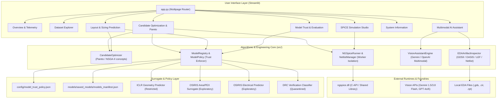

# SiliconPilot AI — System Architecture & Technical Design

## 1. Executive Architectural Overview

**SiliconPilot AI** is an intelligent, local, computer-aided design (CAD) exploration cockpit and engineering assistant for Analog Integrated Circuit (IC) design. It bridges the gap between high-level heuristic circuit sizing, fast machine learning surrogates, deterministic SPICE circuit simulation, and multimodal layout inspection.

The architecture emphasizes **provenance transparency**, **fail-closed trust policies**, and **process isolation**. It explicitly delineates between what is physically simulated, what is statistically estimated, and what is optically observed from layout screenshots.

---

## 2. Core Subsystems

### 2.1. Presentation & Routing Layer (`dashboard/`)
* **Framework:** Native Streamlit multi-page application.
* **Router:** `app.py` sets up page configuration, custom theming (`.streamlit/config.toml`), and sidebar navigation.
* **Pages (`dashboard/pages/`):**
  1. `overview.py`: System health, quick telemetry, environment paths, and quick navigation.
  2. `dataset_explorer.py`: Inspection of raw benchmark caches and sample dataset distributions.
  3. `model_training.py`: Registry status, evaluation reports, model metadata, and trust policy states.
  4. `layout_prediction.py`: Parametric transistor sizing input ($W, L, M, N_{fingers}$), aspect ratio visualization, and surrogate inference.
  5. `candidate_comparison.py`: Multi-objective Pareto candidate exploration, constraint filtering, and trade-off comparison.
  6. `ai_assistant.py`: Interactive engineering dialogue, EDA artifact inspector, and multi-image layout review tray.
  7. `system_info.py`: Machine diagnostics, KiCad / ngspice detection, Python runtime, and provider configs.
  8. `simulation_studio.py`: Parameterized SPICE netlist generation, AC frequency sweeps, transient analyses, and metric extraction.
* **Component Library (`dashboard/components/`):** Reusable layout widgets, metric cards, waveform viewers, and provenance badge renderers.

---

### 2.2. Model Registry & Trust Enforcement (`src/models/`)
* **Registry (`model_registry.py`):** Serializes and versions scikit-learn pipelines with metadata tracking in `models_manifest.json`.
* **Trust Policy (`model_policy.py` & `config/model_trust_policy.json`):**
  * All model invocations pass through `load_model_for_permitted_use()`.
  * **Fail-Closed Resolution:** Missing, corrupted, or unclassified models default to `unapproved` and cannot be invoked.
  * **Policy States:**
    * `quarantined`: Strictly forbidden from inference (e.g., `layout_verification_classifier`).
    * `restricted`: Permitted for metadata review only; barred from candidate ranking (e.g., `iclr_layout_geometry_predictor`).
    * `exploratory`: Permitted for exploratory candidate generation with visible disclaimers (e.g., OSIRIS models).
    * `approved`: Fully validated signoff surrogate (reserved for future calibrated PDK models).

---

### 2.3. Deterministic SPICE Simulation Subsystem (`src/simulation/`)
* **Architecture:** `NGSpiceRunner` interacts directly with `ngspice.dll` via Python `ctypes`.
* **Worker Isolation:** Simulation routines execute inside an isolated child worker process (`multiprocessing`), protecting the main Streamlit application thread from memory corruptions or unhandled DLL faults.
* **Supported Topologies:**
  1. Miller Two-Stage Operational Amplifier
  2. Five-Transistor Operational Transconductance Amplifier (OTA)
  3. Folded Cascode Amplifier
  4. Telescopic Cascode Amplifier
* **Automated Metric Extraction:**
  * **AC Analysis:** DC Open-Loop Gain ($A_v$), Gain-Bandwidth Product (GBW), Phase Margin ($PM$), Unity-Gain Frequency ($f_u$).
  * **Transient Analysis:** Slew Rate ($SR^+$, $SR^-$), Settling Time ($t_s$), Peak Overshoot.
  * **Operating Point Analysis:** Quiescent current consumption, device saturation margins ($V_{dsat}$), total DC power.
* **Path Management on Windows:** Automatically utilizes short 8.3 filesystem paths (`GetShortPathNameW`) to eliminate ngspice parser crashes caused by spaces in OneDrive/User directories.

---

### 2.4. Multimodal AI Assistant & Vision Integration (`src/assistant/`)
* **Hybrid Architecture:**
  1. **Deterministic Local Knowledge Engine:** Fast regex/topic lookup for standard analog textbook rules (differential matching, current mirrors, Miller compensation).
  2. **Cloud Multimodal Vision Providers:** Dual-backend support for Google Gemini (Interactions API / `gemini-3.8-flash`) and OpenAI (Responses API / `gpt-6-astra`).
* **Consent & Privacy Boundary:**
  * Image payloads and prompts are sent to external APIs *only* upon explicit, per-request user consent.
  * Images are held in volatile Streamlit session state and are never persisted to disk or included in exported report JSONs.
* **Strict Evidence Hierarchy:** The vision system prompt enforces structured categorization of output:
  1. `[VISIBLE OBSERVATIONS]`: Optical features (symmetry, interdigitation, guard rings).
  2. `[ENGINEERING INFERENCES]`: Theoretical benefits (gradient cancellation, WPE reduction).
  3. `[UNVERIFIED ASSUMPTIONS & RISKS]`: Physical verification caveats (inability to measure nanometer clearances from pixels).
  4. `[ACTIONABLE RECOMMENDATIONS]`: Best-practice suggestions (dummy gates, substrate taps).

---

### 2.5. EDA Artifact & Netlist Inspector (`src/eda/`)
* **Read-Only Static Ingestion:** Parses physical design and verification artifacts without executing external EDA binaries:
  * **Physical Layout:** GDSII and OASIS file headers, cell hierarchy, bounding boxes, and layer counts via `gdstk`.
  * **Exchange Formats:** DEF (Design Exchange Format) and LEF (Library Exchange Format) component and pin counts.
  * **Verification Reports:** DRC and LVS summary logs from text, JSON, CSV, or HTML sources.
  * **Netlists:** SPICE subcircuit headers, transistor device instances, and pin counts (statically parsed, never simulated without explicit user trigger in Simulation Studio).

---

## 3. Data & Storage Architecture

| Data Asset | Path | Description | Version Control Status |
| :--- | :--- | :--- | :--- |
| **Model Trust Policy** | `config/model_trust_policy.json` | Declarative trust boundaries and permitted usage rules. | Tracked in Git |
| **Model Manifest** | `models/saved_models/models_manifest.json` | Registered model metadata, evaluation metrics, and feature schemas. | Tracked in Git |
| **Sample Benchmark** | `data/sample/osiris_sample.csv` | Synthetic demonstration dataset for offline testing. | Tracked in Git |
| **Sample Generator** | `data/sample/generate_sample.py` | Generator script for synthetic demonstration records. | Tracked in Git |
| **Raw Benchmarks** | `data/raw/` (`index.csv`, `variants.parquet`) | Heavy benchmark datasets (ICLR-ADAPT, OSIRIS). | Excluded (`.gitignore`) |
| **Trained Binaries** | `models/saved_models/*.joblib` | Scikit-learn pickled estimators (>10MB). | Excluded (`.gitignore`) |
| **Simulation History** | `data/simulation_results.db` | SQLite runtime database logging user SPICE simulations. | Excluded (`.gitignore`) |
